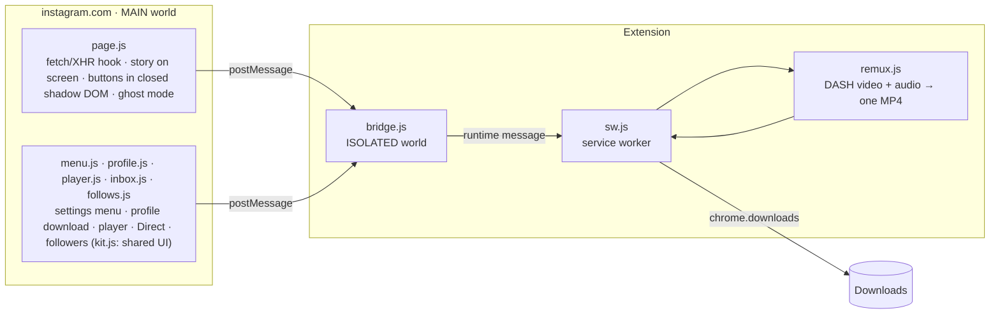

# Salva Stories

**Save what's on your Instagram screen, the way it was posted.**
Stories, posts and whole profiles at original resolution, videos with sound, plus a video player, Direct multi-select and a followers check, all inside Instagram.

&nbsp;&nbsp;

---

## What it does

**Stories**

- **Two round buttons next to the open story:** *save this one* and *save all from this person*. Shortcuts: `D` and `Shift+D`.
- **Photos at the largest size Instagram has**, not the size on screen (for example 1320×2346 when the viewer shows 720×1280).
- **Videos with audio.** By default it saves the progressive MP4 (video + sound in one file). When the original is above 720p, it fetches the separate DASH video and audio tracks and **muxes them in the browser, with no re-encoding**. If that fails, it falls back to the 720p file.
- **Ghost mode** (off by default): the "seen" request isn't sent, so viewing a story doesn't mark it as seen. A ghost badge shows when it's on, in stories and anywhere else on Instagram.

**Profiles**

- A **Download profile** button on any profile saves its posts (photos, videos and every carousel item) into `perfil/fotos` and `perfil/videos`. Choose how many posts and whether you want photos, videos or both.
- It scrolls the grid and keeps the responses Instagram itself loads, at a calm pace (3–6 s per page), instead of calling private endpoints.

**Video player**

- Laid over Instagram's own `<video>` on posts and reels: play/pause, ±10 s, a seek bar, speed from 0.5× to 2×, volume and a download button.
- A pause stays a pause: Instagram's feed tries to resume videos when you scroll, and the player holds them until you press play again (or tap the video yourself).

**Direct**

- Pick several conversations (or *All*, which scrolls the list to the end so Instagram loads every page) and mark them unread/read, pin, mute or delete in one go.
- It works one conversation at a time through Instagram's own menus, with a single confirmation before deleting.

**Followers and following**

- Who doesn't follow you back, who you don't follow back, mutuals, and, from the second check on, **who unfollowed you** and **new followers**. Search, hide verified, sort, ignore list and CSV export.
- Safe by design: only Instagram's `friendships` lists, 1.5–3 s per page with a pause every 15 pages, a full stop on any block or checkpoint, and an incomplete list is never saved. There's **no mass unfollow**, because that's what gets accounts action-blocked. Results stay on your computer.

**Everywhere**

- **Settings inside Instagram**, not in a popup: a story-ring icon in Instagram's left sidebar (or a gear in the story viewer, or `Alt+S`, or the extension icon) opens the menu.
- **Tidy file names:** `Downloads/Instagram Stories/{user}/stories/{user}_{YYYY-MM-DD_HH-MM-SS}_{id}.jpg|mp4`, using the date it was posted. Folder and per-profile subfolder are configurable.
- **Report a bug** and **Check for updates** in the menu footer. *Report a bug* opens a GitHub issue already filled with the version and a short diagnostic (no username, no content). *Check for updates* reads this repo's latest release (also every 6 hours) and shows what changed, with a button that downloads the new zip.
- **Auto / light / dark** theme (auto follows Instagram).

## Install

1. Download **salva-stories-vX.Y.Z.zip** from the [latest release](https://github.com/DredsGG/salva-stories/releases/latest).
2. Open `chrome://extensions` and turn on **Developer mode**.
3. Drag the zip onto the page (or unzip it and use **Load unpacked**). From a clone of this repo, load the `extension/` folder.
4. Reload instagram.com (already open tabs don't get the script until you reload).

If you have other story downloaders installed, turn them off: their buttons sit on top of these.

**Updating:** when a new version is out, the menu shows what changed and an **Update** button that downloads the zip. Extract it over the old folder: the extension notices the new files within a minute and reloads itself and the Instagram tabs. If you installed by dragging the zip, drag the new one instead. A guide page (PT / EN / ES) opens on first install with these steps.

## Usage

| Where | What to do |
| --- | --- |
| Story | Click the top button or press `D` to save it; the second button or `Shift+D` saves every story from that profile. |
| Profile | Click **Download profile**, pick how many posts and the types, then **Download**. Keep the tab open until it finishes. |
| Post or reel with video | Hover the video to show the player; the last button downloads it. |
| Direct | Click the select button, check conversations (or **All**) and pick an action in the bottom bar. |
| Followers | Open the menu → **Tools** → **Followers & following** → scan. Run it again later to see who unfollowed you. |
| Settings | The story-ring icon in Instagram's sidebar, the gear in stories, `Alt+S` or the extension icon. |

## Languages

The interface comes in **Portuguese, English and Spanish**, switched with the flag buttons in the menu.

## Known limitations

- **Chrome (or another Chromium browser) on desktop, on instagram.com only.** No mobile app, no Firefox.
- **It depends on how Instagram's web app works today.** When Instagram changes its responses or layout, a feature can stop until the extension is updated (see [When Instagram changes something](#when-instagram-changes-something)).
- **Updates need one manual step.** Chrome doesn't let an extension installed from a folder replace its own files, so you extract the new zip yourself; only the Chrome Web Store can update fully on its own.
- **"Save all" only covers the stories the viewer already loaded** for that profile.
- **Private profiles** can only be downloaded or checked if you follow them.
- **Big accounts are slow on purpose:** profile downloads and followers checks keep a human-like pace, and the followers check stops on the first block or checkpoint.
- **Direct actions need Instagram in Portuguese, English or Spanish**, because they click Instagram's own menu items by their text.
- The profile download folder is always named `perfil`, whatever the interface language.

## How it works

- **No extra traffic in the normal case.** `page.js` listens to the responses Instagram itself already downloads (the reels media GraphQL payload and inline JSON) and keeps the story items in memory. Only when an item isn't cached does it make a single `media/{id}/info` call.
- **Finding the story on screen:** the biggest `<video>`/`` in the center of the viewer, matched to its media id through React fiber. When the URL already has an id, that one wins, which covers the slide animation between stories.
- **"Save all" uses only the reel the viewer already loaded.** It doesn't do batch API calls, since that's what triggers Instagram's automation checks.
- **Minimal permissions:** `downloads`, `storage` and `alarms`; host access to Instagram's CDN (`*.cdninstagram.com`, `*.fbcdn.net`, needed to fetch DASH tracks), to `www.instagram.com` (to reload its tabs after an update) and to `api.github.com` (to read the latest release). The service worker refuses any download URL that isn't HTTPS on the CDN hosts. No `cookies`, `tabs` or `webRequest`, and nothing about you is sent anywhere: the only outside request is that read-only release check.
- **`remux.js`** is a small dependency-free fMP4 muxer: it copies the `moov`/`trak` boxes, renumbers `track_ID` and interleaves `moof`/`mdat` fragments by their decode time.

### When Instagram changes something

Open the console on instagram.com and run `__salvaStoriesDebug()`. It shows how many items are cached, the current story id and the settings:

- `items: 0` → the response format changed: look at `harvest()` and `WATCH` in `page.js`.
- `current: null` → the viewer layout or fiber changed: look at `pkFromFiber()` and `centerMedia()`.

*Report a bug* in the menu attaches the same information plus a short log. Each module also has its own helper with its state and the on-screen position of its controls: `__salvaStoriesMenuDebug()`, `__salvaStoriesProfileDebug()`, `__salvaStoriesPlayerDebug()`, `__salvaStoriesInboxDebug()` and `__salvaStoriesFollowsDebug()`.

## Tests

End-to-end in Chromium with the real extension loaded, against a simulated instagram.com and CDN. Setup is in [`tests/README.md`](tests/README.md).

- `e2e.mjs`, stories: photo at the largest candidate with the right name, 1080p DASH video muxed with audio (checked with `ffprobe`), video without sound, `Shift+D` saving three, max-resolution off, ghost mode blocking only when on, and the settings menu.
- `e2e-v15.mjs`, everything else, in light and dark: ghost badge outside stories, a 30-post profile with carousels saved as 34 files in the right folders, the player (pause that survives the page trying to resume it, ±10 s, 2×, sound, volume, download), Direct (all 40 chats selected, 2 marked unread, 2 deleted after one confirmation), two followers checks with unfollowers and new followers, and the update notice and bug report.

The screenshots on this page are the real extension (v1.5.2) running on that simulated Instagram, with placeholder accounts and generated images.

## Disclaimer

Personal project, not affiliated with or endorsed by Instagram or Meta. Downloading content may go against Instagram's Terms of Use. Save only for personal use, don't re-post other people's content, and respect the creators.

## License

[MIT](LICENSE) · made by [André Miller Fleck (Dreds)](https://github.com/DredsGG)
