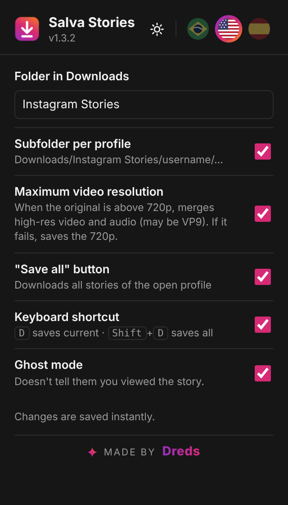
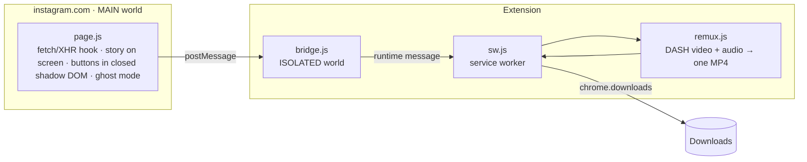

# Salva Stories

**Save the Instagram story that's on your screen, the way it was posted.**
Photos at their original resolution, videos with sound, one click or one key.

---

## What it does

- **Two round buttons next to the open story:** *save this one* and *save all from this person*. Shortcuts: `D` and `Shift+D`.
- **Photos at the largest size Instagram has**, not the size on screen (for example 1320×2346 when the viewer shows 720×1280).
- **Videos with audio.** By default it saves the progressive MP4 (video + sound in one file). When the original is above 720p, it fetches the separate DASH video and audio tracks and **muxes them in the browser, with no re-encoding**. If that fails, it falls back to the 720p file.
- **Tidy file names:** `Downloads/Instagram Stories/{user}/{user}_{YYYY-MM-DD_HH-MM-SS}_{id}.jpg|mp4`, using the date the story was posted. Folder and per-profile subfolder are configurable.
- **Ghost mode** (off by default): the "seen" request isn't sent, so viewing a story doesn't mark it as seen.
- **PT / EN / ES** with flag buttons, **light / dark** theme.

## Install

1. Download **salva-stories-vX.Y.Z.zip** from the [latest release](https://github.com/DredsGG/salva-stories/releases/latest).
2. Open `chrome://extensions` and turn on **Developer mode**.
3. Drag the zip onto the page (or unzip it and use **Load unpacked**). From a clone of this repo, load the `extension/` folder.
4. Reload instagram.com (already open tabs don't get the script until you reload).

If you have other story downloaders installed, turn them off: their buttons sit on top of these.

## How it works

- **No extra traffic in the normal case.** `page.js` listens to the responses Instagram itself already downloads (the reels media GraphQL payload and inline JSON) and keeps the story items in memory. Only when an item isn't cached does it make a single `media/{id}/info` call.
- **Finding the story on screen:** the biggest `<video>`/`` in the center of the viewer, matched to its media id through React fiber. When the URL already has an id, that one wins, which covers the slide animation between stories.
- **"Save all" uses only the reel the viewer already loaded.** It doesn't do batch API calls, since that's what triggers Instagram's automation checks.
- **Minimal permissions:** `downloads`, `storage`, and host access only to Instagram's CDN (`*.cdninstagram.com`, `*.fbcdn.net`), needed to fetch DASH tracks. The service worker refuses any URL that isn't HTTPS on those hosts. No `cookies`, `tabs` or `webRequest`, and nothing is sent to any outside server.
- **`remux.js`** is a small dependency-free fMP4 muxer: it copies the `moov`/`trak` boxes, renumbers `track_ID` and interleaves `moof`/`mdat` fragments by their decode time.

### When Instagram changes something

Open the console on instagram.com and run `__salvaStoriesDebug()`. It shows how many items are cached, the current story id and the settings:

- `items: 0` → the response format changed: look at `harvest()` and `WATCH` in `page.js`.
- `current: null` → the viewer layout or fiber changed: look at `pkFromFiber()` and `centerMedia()`.

## Tests

End-to-end in Chromium with the real extension loaded, against a simulated instagram.com and CDN (7/7 passing in the last run): photo at the largest candidate with the right name, 1080p DASH video muxed with audio (checked with `ffprobe`), video without sound, `Shift+D` saving three, max-resolution off, ghost mode blocking only when on, and the popup. Setup is in [`tests/README.md`](tests/README.md).

## Disclaimer

Personal project, not affiliated with or endorsed by Instagram or Meta. Downloading content may go against Instagram's Terms of Use. Save only for personal use, don't re-post other people's content, and respect the creators.

## License

[MIT](LICENSE) · made by [André Miller Fleck (Dreds)](https://github.com/DredsGG)
