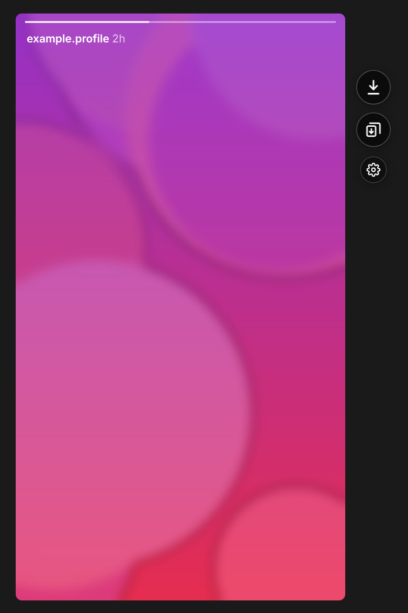
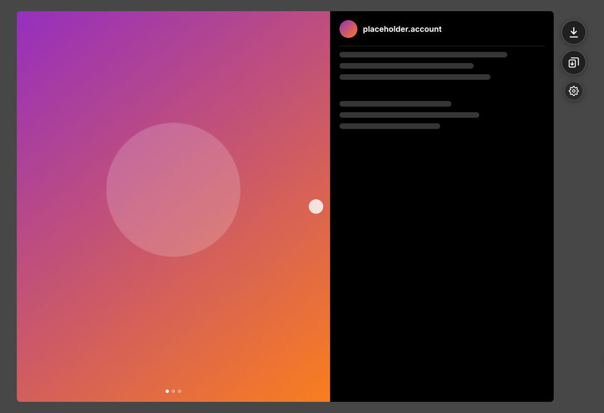
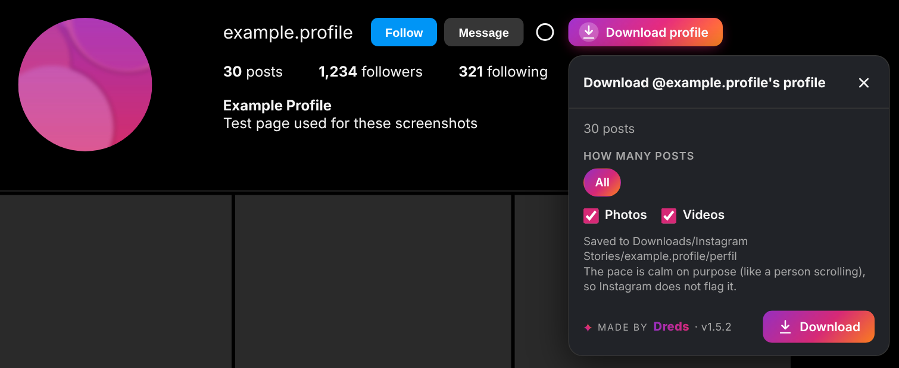
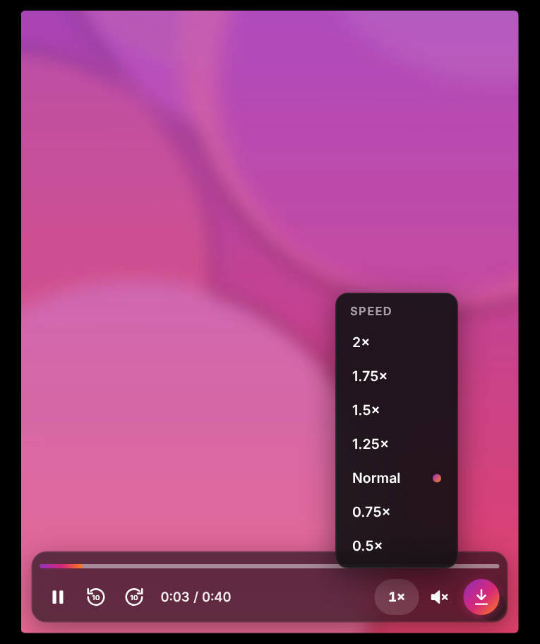
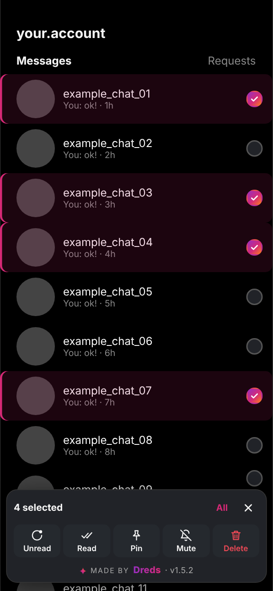
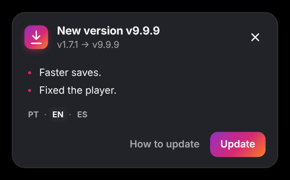
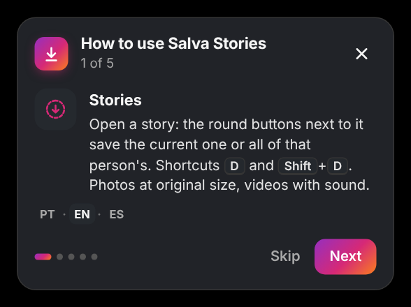
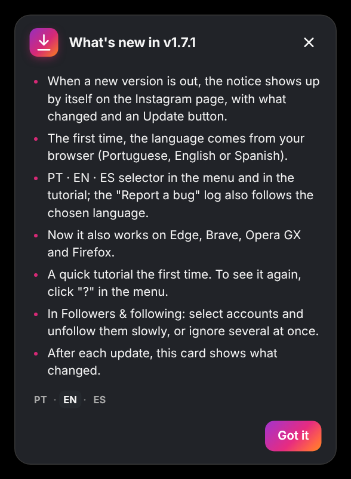
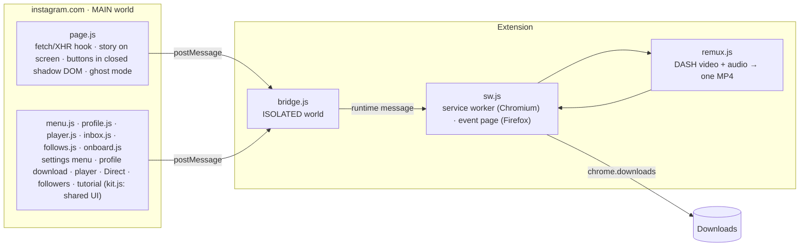

# Salva Stories

**Save what's on your Instagram screen, the way it was posted.**
Stories, posts and whole profiles at original resolution, videos with sound, plus a video player, Direct multi-select and a followers check, all inside Instagram.

**Works on:** Chrome · Edge · Brave · Opera GX · Firefox 140+

&nbsp;&nbsp;

---

## What it does

**Stories**

- **Two round buttons next to the open story:** *save this one* and *save all from this person*. Shortcuts: `D` and `Shift+D`.
- **Photos at the largest size Instagram has**, not the size on screen (for example 1320×2346 when the viewer shows 720×1280).
- **Videos with audio.** By default it saves the progressive MP4 (video + sound in one file). When the original is above 720p, it fetches the separate DASH video and audio tracks and **muxes them in the browser, with no re-encoding**. If that fails, it falls back to the 720p file.
- **Video stories at 0.5×, 1.5× or 2×:** hover the speed button next to the story and pick from the vertical list. The speed sticks for the next stories (Instagram moves on when the video ends, so 2× really is twice as fast). Photo stories keep Instagram's own timer.
- **Ghost mode** (off by default): the "seen" request isn't sent, so viewing a story doesn't mark it as seen. A ghost badge sits in the story buttons and under our sidebar icon: lit when ghost mode is on, dimmed when it's off. Click it to turn ghost mode on or off.

**Posts**

- **The same round buttons on an open post** (from the feed or a profile, in the pop-up or on its own page): *save the photo or video on screen* and *save the whole carousel*, in order. Shortcuts: `D` and `Shift+D`. Single photos only get the first button.
- They sit outside the post, to the right, and stay still while you swipe through the carousel. In a narrow window they move inside the photo's top corner.
- **On the home feed too:** the same buttons show up next to the post on screen, follow you as you scroll and save the photo or video you're looking at, or the whole carousel.
- Files land in the same place and with the same names as **Download profile** (`perfil/fotos` or `perfil/videos`, `YYYY-MM-DD_{code}_NN`), so downloading the profile later doesn't create duplicates. You can turn the buttons off in the menu (*Tools* → *Post buttons*).

**Profiles**

- **Large profile picture:** click someone's profile picture (or hold it, if they have a story) to see it at its original size, usually 1080×1080, in a square in the middle of the screen, with a Save button. It comes from the data Instagram already loads for the profile, with no extra request. On your own profile, only holding opens it (the click still changes your photo).
- A **Download profile** button on any profile saves its posts (photos, videos and every carousel item) into `perfil/fotos` and `perfil/videos`. Choose how many posts and whether you want photos, videos or both.
- It scrolls the grid and keeps the responses Instagram itself loads, at a calm pace (3–6 s per page), instead of calling private endpoints.

**Video player**

- Laid over Instagram's own `<video>` on posts and reels: play/pause, ±10 s, a seek bar, speed from 0.5× to 2×, volume and a download button.
- A pause stays a pause: Instagram's feed tries to resume videos when you scroll, and the player holds them until you press play again (or tap the video yourself).
- On Reels, the bar follows the reel on screen when you move to the next one, every click on pause and the speaker counts, and the bar stays put while the mouse rests on it.
- **Reels with sound.** Sound is on from the start on Reels and stays on as you swipe to the next one. If you mute, it stays muted until you leave Reels. You can turn this off in the menu, under Tools.

**Direct**

- Pick several conversations (or *All*, which scrolls the list to the end so Instagram loads every page) and mark them unread/read, pin, mute or delete in one go.
- It works one conversation at a time through Instagram's own menus, with a single confirmation before deleting.

**Followers and following**

- Who doesn't follow you back, who you don't follow back, mutuals, and, from the second check on, **who unfollowed you** and **new followers**. Search, hide verified, sort, ignore list and CSV export.
- **Unfollow or ignore in bulk:** check accounts one by one or *Select all*, then **Unfollow (N)** or **Ignore (N)**, with a single confirmation. Unfollowing goes through Instagram's own function, slowly on purpose: 8–16 s between accounts, a 3–5 min pause every 10 and at most 150 a day. It stops on any block or after 3 failures in a row.
- Safe scanning: only Instagram's `friendships` lists, 1.5–3 s per page with a pause every 15 pages, a full stop on any block or checkpoint, and an incomplete list is never saved. Results stay on your computer.

**Everywhere**

- **Settings inside Instagram**, not in a popup: a story-ring icon in Instagram's left sidebar (or a gear in the story viewer, or `Alt+S`, or the extension icon) opens the menu.
- **Tidy file names:** `Downloads/Instagram Stories/{user}/stories/{user}_{YYYY-MM-DD_HH-MM-SS}_{id}.jpg|mp4`, using the date it was posted. Folder and per-profile subfolder are configurable.
- **Report a bug** and **Check for updates** in the menu footer. *Report a bug* opens a GitHub issue already filled with the version and a short diagnostic (no username, no content). *Check for updates* reads this repo's latest release right away; the extension also checks by itself when you open Instagram, when you come back to the tab (at most every 10 minutes) and every 30 minutes.
- **Update notice on the page itself:** as soon as a new version is out, a compact *New version vX.Y.Z* card shows up by itself in the middle of the Instagram page you're on, without reloading, with what changed and an **Update** button that does the right thing for your browser (downloads the zip on Chromium, opens the signed `.xpi` on Firefox). ✕ or `Esc` only snooze it: it comes back after an hour or the next time you open Instagram, until you update.
- **Urgent updates:** when a release is marked *URGENTE* (a serious bug), the card can't be dismissed and the extension pauses until you update: downloads are refused with a notice, and long jobs (profile download, Direct, followers, unfollow) wait where they are and carry on by themselves after the update.
- **First-run tutorial and what's new:** a short tutorial the first time (Skip / Got it; reopen it with **?** in the menu), and after each update a *What's new* card, once per version. Both also show up in the middle of the screen, never block anything and close with ✕ or `Esc`.
- **Auto / light / dark** theme (auto follows Instagram).

&nbsp;&nbsp;&nbsp;&nbsp;

## Install

Download the files from the [latest release](https://github.com/DredsGG/salva-stories/releases/latest), then follow the steps for your browser. After installing, reload instagram.com (tabs that were already open don't get the script until you reload). If you have other story downloaders installed, turn them off: their buttons sit on top of these.

### Chrome, Edge, Brave and Opera GX

1. Download **salva-stories-vX.Y.Z.zip** and extract it into a folder you'll keep (for example `Documents\Salva Stories`).
2. Open the extensions page: `chrome://extensions`, `edge://extensions`, `brave://extensions` or `opera://extensions`.
3. Turn on **Developer mode**, click **Load unpacked** and pick the folder.
4. **To update:** extract the new version over the same folder, or use the extension's **Update** button (menu footer), which downloads the zip for you. The extension notices the new files within a minute and reloads itself and the Instagram tabs.

> **Opera GX:** if the extension disappears after you close the browser, just load the folder again (a known Opera issue with unpacked extensions).

### Firefox (140 or newer)

1. Download **salva-stories-vX.Y.Z.xpi** (signed by Mozilla) and confirm the installation. If Firefox only saves the file, open `about:addons` → gear → **Install Add-on From File** and pick it.
2. That's it: Firefox **updates it by itself**.
3. Firefox lets you remove an extension's site access in `about:addons` → Salva Stories → **Permissions**. If access to Instagram is missing, the toolbar icon shows **!** and the menu shows an **Allow access** button.

> No `.xpi` in the release yet? Use `about:debugging` → **This Firefox** → **Load Temporary Add-on** and pick `manifest.json` in the unzipped folder (it's removed when Firefox closes).

## Usage

| Where | What to do |
| --- | --- |
| Story | Click the top button or press `D` to save it; the second button or `Shift+D` saves every story from that profile. Hover the speed button (`1×`) to watch a video story at 0.5×, 1.5× or 2×. |
| Post | Open it, or just scroll the home feed: the top button next to the post (or `D`) saves the photo or video on screen; the second one (or `Shift+D`) saves the whole carousel. |
| Profile | Click **Download profile**, pick how many posts and the types, then **Download**. Keep the tab open until it finishes. Click the profile picture (hold it if there's a story) to see it full size and save it. |
| Post or reel with video | Hover the video to show the player; the last button downloads it. |
| Direct | Click the select button, check conversations (or **All**) and pick an action in the bottom bar. |
| Followers | Open the menu → **Tools** → **Followers & following** → scan. Run it again later to see who unfollowed you. |
| Settings | The story-ring icon in Instagram's sidebar, the gear in stories, `Alt+S` or the extension icon. **?** reopens the tutorial. |

## Languages

Everything comes in **Portuguese, English and Spanish**: menu, footer, tutorial, *What's new*, notices, the install guide and the log that goes with *Report a bug*. The first time, it follows your browser's language (any other language falls back to English). Switch any time with **PT · EN · ES** in the menu footer (also on the tutorial and notice cards, and the flags under Appearance); the choice is saved.

## Known limitations

- **Desktop browsers on instagram.com only** (Chrome, Edge, Brave, Opera GX, Firefox 140+). No mobile app.
- **It depends on how Instagram's web app works today.** When Instagram changes its responses or layout, a feature can stop until the extension is updated (see [When Instagram changes something](#when-instagram-changes-something)).
- **On Chromium browsers, updates need one manual step.** An extension loaded from a folder can't replace its own files, so you extract the new zip yourself. Firefox updates the signed `.xpi` by itself.
- **Bulk unfollow is slow by design** (at most 150 a day). Instagram may still action-block an account that unfollows a lot; use it at your own risk.
- **"Save all" only covers the stories the viewer already loaded** for that profile.
- **Private profiles** can only be downloaded or checked if you follow them.
- **Big accounts are slow on purpose:** profile downloads and followers checks keep a human-like pace, and the followers check stops on the first block or checkpoint.
- **Direct actions need Instagram in Portuguese, English or Spanish**, because they click Instagram's own menu items by their text.
- The profile download folder is always named `perfil`, whatever the interface language.

## How it works

- **No extra traffic in the normal case.** `page.js` listens to the responses Instagram itself already downloads (the reels media GraphQL payload and inline JSON) and keeps the story items in memory. Only when an item isn't cached does it make a single `media/{id}/info` call.
- **Finding the post on screen:** the post's data (every carousel item, in order) comes from the same responses Instagram already loads (the grid, the post pop-up or the inline JSON of `/p/{code}/`), indexed by its shortcode. The item on screen is the image inside the carousel window whose file name matches one of the item's candidates (video: React fiber; fallback: `img_index` in the URL, or on the home feed the carousel slide's own `translateX` position). On the home feed, each post is an `<article>` and its shortcode comes from the post's date link.
- **Finding the story on screen:** the biggest `<video>`/`` in the center of the viewer, matched to its media id through React fiber. When the URL already has an id, that one wins, which covers the slide animation between stories.
- **"Save all" uses only the reel the viewer already loaded.** It doesn't do batch API calls, since that's what triggers Instagram's automation checks.
- **Minimal permissions:** `downloads`, `storage` and `alarms` (and `permissions.contains` to warn when Firefox site access was removed); host access to Instagram's CDN (`*.cdninstagram.com`, `*.fbcdn.net`, needed to fetch DASH tracks), to `www.instagram.com` (to reload its tabs after an update) and to `api.github.com` (to read the latest release). The service worker refuses any download URL that isn't HTTPS on the CDN hosts. No `cookies`, `tabs` or `webRequest`, and nothing about you is sent anywhere: the only outside request is that read-only release check.
- **One package for every browser:** the manifest declares the background as both `service_worker` (Chromium) and `scripts` (Firefox), pointing to the same ES module, so `sw.js` uses no `window`/DOM and only promise-style `browser.*`/`chrome.*` calls. On Firefox the muxed DASH video is saved through a `blob:` URL; on Chromium through a `data:` URL. `browser_specific_settings.gecko` sets the add-on id `salva-stories@dredsgg`, Firefox 140+, no data collection, and the `update_url` (`firefox/updates.json`).
- **`remux.js`** is a small dependency-free fMP4 muxer: it copies the `moov`/`trak` boxes, renumbers `track_ID` and interleaves `moof`/`mdat` fragments by their decode time.

### When Instagram changes something

Open the console on instagram.com and run `__salvaStoriesDebug()`. It shows how many items are cached, the current story id and the settings:

- `items: 0` → the response format changed: look at `harvest()` and `WATCH` in `page.js`.
- `current: null` → the viewer layout or fiber changed: look at `pkFromFiber()` and `centerMedia()`.

*Report a bug* in the menu attaches the same information plus a short log. Each module also has its own helper with its state and the on-screen position of its controls: `__salvaStoriesMenuDebug()`, `__salvaStoriesProfileDebug()`, `__salvaStoriesPlayerDebug()`, `__salvaStoriesInboxDebug()`, `__salvaStoriesFollowsDebug()` and `__salvaStoriesOnboardDebug()`.

## Tests

End-to-end with the real extension loaded, against a simulated instagram.com and CDN. Setup is in [`tests/README.md`](tests/README.md).

- `e2e.mjs`, stories: photo at the largest candidate with the right name, 1080p DASH video muxed with audio (checked with `ffprobe`), video without sound, `Shift+D` saving three, max-resolution off, ghost mode blocking only when on, and the settings menu.
- `e2e-v15.mjs`, everything else, in light and dark: ghost badge outside stories, a 30-post profile with carousels saved as 34 files in the right folders, the player (pause that survives the page trying to resume it, ±10 s, 2×, sound, volume, download), Direct (all 40 chats selected, 2 marked unread, 2 deleted after one confirmation), two followers checks with unfollowers and new followers, bulk ignore and unfollow, and the update notice and bug report.
- `e2e-onboard.mjs` (in PT, EN and ES): the tutorial on a fresh install, the **?** button, `Esc`, *What's new* once after a simulated update, and a newer simulated release: the notice shows up by itself on the page, comes back after a reload, **Update** downloads the zip, ✕ only snoozes it, and it waits for the tutorial to close.
- `e2e-update14.mjs`, with the page open the whole time and a simulated GitHub: check on open, no extra check when coming back within 10 minutes, a check after that showing the card in the middle without a reload, ✕ snoozing for an hour (clock fast-forwarded) and the card back on the next visit, then an *URGENTE* release: no ✕, `Esc` ignored, downloads refused, long jobs paused, and everything back once it's resolved.
- `e2e-post.mjs`: post buttons on a carousel pop-up (photo, video, photo), swiping without the buttons moving or blinking, `D` and `Shift+D` with the right names, a single post, a post opened on its own page, scrolling away, a narrow window and the menu switch.
- `e2e-reels.mjs`: the player on a Reels-like page with human-paced clicks (press, 120 ms, release): pause and the speaker act on the reel on screen after moving to the next one, the speaker stays under the mouse when the volume slider opens, and the bar stays while the mouse rests on it.
- `e2e-avatar.mjs`: the large profile picture. Without a story a click opens it at 1080 without leaving the page, Save uses the right folder and name, Esc and a click outside close it; with a story (data from GraphQL) holding opens it and the story doesn't, a short click still opens the story; your own profile, a profile without the full-size data (warning) and the menu switch.
- `e2e-story-speed.mjs`: speed in video stories (the vertical list opens on hover, 2× applied and re-applied when the page resets it, dimmed on photo stories, kept on the next video and after a reload, the menu switch) and the ghost badge turning ghost mode on and off, in a story and on the sidebar.
- `e2e-feed.mjs`: buttons on the home feed (a carousel with photo, video and photo, a single photo and a reel): `D`, `Shift+D` and a real click with the right names, moving to the next post as you scroll, hiding while scrolling, and the menu switch; plus our sidebar icon and ghost badge hiding while Instagram's "More" menu is open over them.
- `e2e-reels-sound.mjs`: sound on Reels. It's on when you enter Reels, stays on across reels, our speaker changes Instagram's own mute state, a mute holds until you leave Reels and comes back on when you return, and with the setting off nothing is touched.
- `e2e-flick.mjs`: the story buttons only ever show at their final spot while Instagram slides to the next person, and come back before the slide finishes.
- `e2e-lang.mjs`: first run with the browser in pt-BR, pt-PT, en-US, es-ES, es-419 and de-DE (falls back to English), then switching PT · EN · ES in the footer, tutorial, menu, *What's new* and the bug report log.
- **Firefox** (GitHub Actions, `Test` workflow): `web-ext lint` with no errors, then real Firefox with the extension installed as temporary: tutorial, menu and footer, update check, story photo with `D`, DASH video muxed through `blob:` (checked with `ffprobe`) and *What's new*.

The screenshots on this page are the real extension (v1.7.1, and v1.8.6 for the post buttons) running on that simulated Instagram, with placeholder accounts and generated images.

## Disclaimer

Personal project, not affiliated with or endorsed by Instagram or Meta. Downloading content may go against Instagram's Terms of Use. Save only for personal use, don't re-post other people's content, and respect the creators.

## License

[MIT](LICENSE) · made by [André Miller Fleck (Dreds)](https://github.com/DredsGG)
